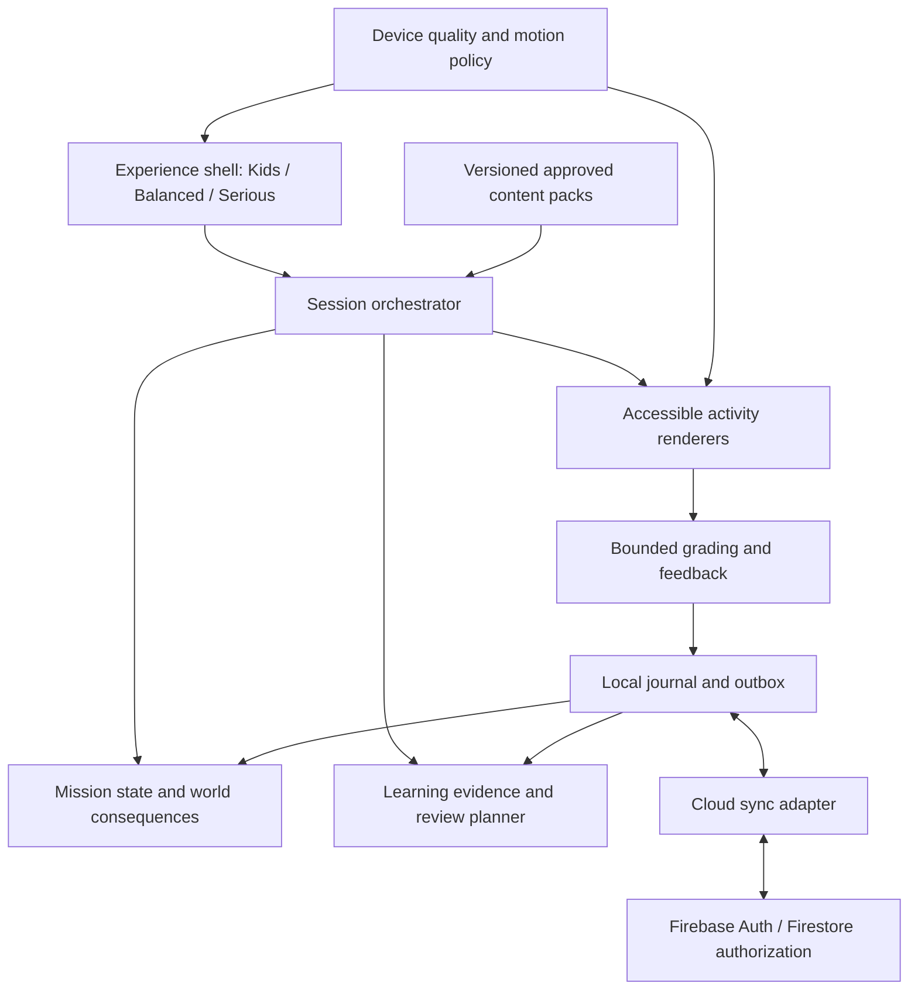

# Phase 1 — Product discovery, game design, and architecture proposal

> Historical proposal. The owner's autonomous-release directive supersedes its
> approval gates and technical prescriptions. See [current state](PROJECT_STATE.md)
> and [architecture](architecture.md) for the implementation and remaining gates.

Current status: the later Atlas refinement and initial architecture were approved
for P0. See [P0 implementation and remaining gates](p0-status.md). The original
approval language below is historical, not a new request to reapprove P0.

Date: 16 October 2026. Status: **awaiting foundational approval**.

Amendment: the [focused Phase 1 refinement](phase-1-refinement.md) supersedes this
document's game recommendation, mode gameplay description, first-playable sequence
and initial data-batch size. Other analysis remains the baseline. Neither game
direction has been approved. Native delegation is assessed separately; the manual
Luna checkpoint remains active.

This report covers all nine requested Phase 1 deliverables. Recommendations below
are proposed decisions; they do not imply approval, implementation, deployment, or
validated educational effectiveness. Current service and browser claims were
checked against official documentation during this phase. Recheck them before
provisioning and deployment because terms and capabilities can change.

## Executive recommendation

Build **Common Ground**, a working title for a compact communication simulation.
Players help a recurring community complete projects by understanding information,
repairing misunderstandings, and creating useful English messages. Their decisions
produce visible, understandable changes in one small place.

Use one bounded mission engine and one independent learning engine, presented
through Kids, Balanced, or Serious session flows. Keep game accomplishments,
English evidence, and personal preferences separate. Build accessible DOM/SVG
interfaces with Svelte, TypeScript, and Vite. Deploy static assets on GitHub Pages.
Save locally first; use Firebase Spark with Google sign-in and Firestore for
approved family accounts and recoverable synchronization. Keep billing disabled.

The first development milestone is one complete mission plus a later return
encounter, using a small labelled synthetic fixture set. It tests the game loop,
mode switching, both guidance languages, save/resume, accessibility, and quality
equivalence before commissioning production content. Then stop for the mandatory
Luna handoff. No production data is needed to complete Phase 1.

## 1. Requirements analysis

### Hard constraints

- Approximately ten private family learners; design and operations must fit that scale.
- GitHub Pages frontend; no conventional maintained backend server.
- Free or nearly free operation; explicit approval before material costs or new obligations.
- Architecture accommodates A1–C2; content may expand in reviewed stages.
- Kids, Balanced, and Serious are meaningfully different experiences, changeable
  without losing progress or redefining proficiency.
- Vietnamese-assisted and English-only guidance are independent of experience mode.
- Eco, Balanced, Ultra, and Auto quality preserve all essential learning functionality.
- Personal profiles and durable progress, with cross-device access where feasible.
- Production content research and bulk generation go through the user's separate
  Luna 6 conversation and the required stop-and-handoff protocol.
- Foundational concept and architecture require approval before major implementation.

### Product goals

Create a coherent game with recognizable identity, useful learning, replayable
practice, sustained but healthy motivation, and sessions that suit different ages,
abilities, confidence levels, and amounts of available time. Users should be able
to explain both what they accomplished in the world and what they learned.

### Quality requirements

Educational accuracy and honest assessment; accessible keyboard/touch interfaces;
low cognitive load; responsive low-end operation; progress consistency; private
data isolation; resilient saving and recovery; safe content integration; clear
module boundaries; small operational burden; reproducible validation and useful
documentation. These are release gates, not adjectives applied to an untested build.

### Flexible decisions

Genre, setting, art, rendering, framework, lesson structure, rewards, authentication
provider, database, review algorithm, social features, and parental-control scope
are design choices. This report selects a direction while preserving inexpensive
replacement points around content, rendering, and cloud persistence.

### Important uncertainties and responses

| Unknown or tension | Proposed response |
|---|---|
| Actual family ages, literacy, devices, and English profiles are unknown | Begin with neutral family-safe material; collect a small device/accessibility inventory and observe representative learners during the first milestone |
| A1–C2 ambition exceeds a small initial library | Design the full level model now; publish explicit coverage; expand A1–A2, B1–B2, then C1–C2 |
| A small automated intake cannot establish full CEFR proficiency | Return a suggested practice range and per-skill evidence, including unassessed skills |
| Fluent production is valuable but expensive to evaluate reliably | Combine bounded automatic checks with models, revision, self-review, and optional competent human review |
| A private family product uses a public static host | Protect personal records in external authorization rules; treat app assets and shipped answers as public |
| Free services have quotas and may change | Use a no-billing plan, downloaded practice, exports, provider-neutral data, and documented failure handling |
| Three experiences could triple scope | Share semantic mission state and learning evidence; vary session composition and scaffolding |
| Advanced tasks may be unsuitable for young children | Separate content suitability and cognitive/literacy demands from mode and CEFR; expose missing coverage honestly |
| Guardian profiles need convenience without a new identity platform | Use guardian-owned dependent profiles for trusted use; disclose the security boundary |

No unknown prevents a concept decision. Real-device sign-in, engagement, content
review availability, and advanced-level coverage remain validation work rather
than assumptions of success.

## 2. Game concept exploration

All three candidates use English to accomplish a purpose. They differ in the
player's main activity, content burden, and long-term motivation.

| Dimension | Common Ground: communication simulation | The Missing Signal: evidence investigation | Studio Almanac: creative publishing |
|---|---|---|---|
| Core loop | Understand a request, gather information, communicate a plan, observe a result, revise | Gather evidence, compare accounts, develop and justify an explanation, resolve a case | Receive a brief, select material, create an artifact, revise, publish |
| Learning integration | Meaning, precision, register, and clarity determine whether another person can act | Reading/listening, inference, contradictions, and evidence support an explanation | Audience, cohesion, accuracy, and tone improve a useful publication |
| Progression | Community projects, relationships, new commissions, a changing place | Case archive, investigation tools, linked mysteries | Portfolio, editorial responsibility, more demanding commissions |
| Engagement strength | Visible contribution and attachment to a place | Curiosity and satisfying discoveries | Ownership and expression |
| Kids | Guided concrete errands, illustrated information, reversible mistakes | Gentle short mysteries with explicit clues | Signs, postcards, illustrated guides with templates |
| Balanced | Project choice, exploration, connected decisions | Open evidence exploration and optional leads | Commission choice, gathering material, revision and presentation |
| Serious | Direct work orders, objectives, focused practice and visible project outcomes | Compact case files and evidence analysis | Editorial workbench, criteria and revision history |
| Content scalability | Reusable situational structures with bounded outcomes | Each case needs careful contradiction and spoiler testing | Reusable briefs, but strong rubrics and examples are demanding |
| Technical complexity | Moderate: mission state, structured interactions, a small changing scene | Low–moderate: evidence navigation and case state | Moderate: accessible composition and revision tools |
| Low-end performance | Strong with DOM/SVG and optional effects | Strong; mostly documents and audio | Good if it avoids becoming a general-purpose page designer |
| Maintenance burden | Control branching and world state | High bespoke authoring burden per convincing case | Open-ended evaluation and editor complexity |
| Principal weakness | Could become logistical puzzles or quizzes with decorative consequences | Can overemphasize comprehension; solved mysteries lose replay value | Reliable automatic assessment of creative output is limited |

An action/arcade foundation was also considered. It could create immediate
excitement, but would confound learning evidence with motor speed, device latency,
and game familiarity. It is a poor foundation for this audience. Any future timed
activity must be optional and must not control access to learning or proficiency.

Recommendation: Common Ground as the foundation. Evidence investigation and
artifact creation fit naturally within its missions; they do not need separate
game systems. This captures their strengths while limiting custom case and editor scope.

## 3. Recommended player experience

### Identity and world

A warm, restrained illustrated courtyard connects a workshop, garden, noticeboard,
and small station. A few recurring characters have understandable projects. Use
clear typography, expressive details, and attractive composition rather than a
large world, combat, elaborate physics, or an unrestricted life simulation.

The world is personally persistent initially. A learner sees their own projects
and contributions. Defer a shared live world until individual saving is reliable;
this avoids social permissions, simultaneous edits, and comparison pressure in the core.

### A concrete journey

The following is a fictional design illustration, not production learning content.

The community is preparing an evening event. Two notices seem to disagree about
access to the garden. A volunteer's message explains that one entrance closes
early. The player inspects the sources, prepares an update for visitors, and checks
whether it gives them enough information. If the message is unclear, the response
shows the practical problem and offers a chance to revise. The noticeboard changes
and the project advances after a useful contribution.

An early-level route identifies essential places and times and constructs a brief
message. An intermediate route combines sources and explains an alternative.
An advanced route handles uncertain information, apparent contradiction, tone,
and audience adaptation. Advanced work changes the communicative demand; it is
not the same task with longer vocabulary.

The player later encounters related language in a different practical situation.
That is the replay loop: fresh communication using returning knowledge, with
optional alternate solutions and new project contexts.

### What makes it a game

- The player has agency over projects, information gathering, and useful decisions.
- English changes the situation: instructions can be followed, ambiguity can be
  resolved, and plans can become understandable.
- Progress leaves persistent, visible evidence in the place and a contribution journal.
- Mistakes create recoverable misunderstandings, not lost lives or distressed characters.
- Revisions, discoveries, and increasing independence earn recognition.

Avoid a consumable economy, random loot, streak penalties, energy meters,
mandatory attendance, paid advantages, and rewards that buy mastery. Replaying
an answer may be enjoyable practice, but cannot repeatedly mint skill evidence or
duplicate a unique project reward.

The central engagement hypothesis is unproven: will these particular learners
enjoy making a persistent place work better? A complete playable loop is the
appropriate first experiment. If it fails, revise agency and consequences before
investing in a large content library or visual polish.

The first mission must include a consequential choice with at least two valid
communication solutions: for example, clarify an alternative route or reschedule
the activity. The information and message the player prepares must affect the
choice and its outcome. Test whether players can bypass the English through
visual or logistical shortcuts. A single correct answer unlocking scenery is
insufficient evidence that the concept works.

### Three deliberate session flows

| Aspect | Kids | Balanced | Serious |
|---|---|---|---|
| Entry | Helper presents one immediate contribution | Choose a community project and approach | Choose an objective, due review, or compact work order |
| Information | Small steps and visual demonstrations | Explore relevant sources with optional discoveries | Direct source access, concise framing, explicit requirements |
| Interaction | Concrete actions, guided repair, larger controls | Decisions and linked task chains | Efficient navigation, focused practice and deliberate revision |
| Feedback | Brief encouragement plus one actionable explanation | Consequence first, useful explanation alongside | Fuller rationale, alternatives, evidence and error history |
| Reward | Visible constructive change and a celebration that can be skipped | Project milestones and discoveries | Contribution record, growing independence, useful progress evidence |
| Session shape | Frequent natural stopping points | A complete mission or several connected contributions | User-selected focused block; optional longer work |

These are defaults, not assumed age or ability. Keep audio, text size, and motion
preferences available in every mode. An older beginner can choose Serious; an
advanced adult can choose Kids. A user may override recommended session length.

Switch mode by saving a semantic checkpoint: source inspected, draft saved,
response submitted, project effect earned. Reframe the next stable activity
boundary without discarding a draft or grading twice. Guidance-language changes
can update chrome and explanations immediately. Mode changes never change CEFR,
family grants, content suitability, achievements, or historical support records.

## 4. Learning system blueprint

### Evidence and educational foundation

The Council of Europe's action-oriented approach treats learners as people using
language for connected purposes, including reception, production, interaction,
and mediation. That supports the mission structure; it is not evidence that this
specific game will be effective. [Council of Europe: action-oriented approach](https://www.coe.int/en/web/common-european-framework-reference-languages/the-action-oriented-approach)

The CEFR supports uneven skill profiles. Use its descriptors as references for
original communicative objectives rather than treating a level as a vocabulary
count. C2 does not require absolute perfection. [CEFR Companion Volume](https://rm.coe.int/common-european-framework-of-reference-for-languages-learning-teaching/16809ea0d4)

Repeated retrieval and distributed practice have experimental support. A foreign
language vocabulary study found delayed benefits from continuing retrieval after
initial success; spacing research shows that useful intervals depend on intended
retention delay. These findings motivate review, without proving one universal
scheduler or transfer to all communicative skills. [Karpicke and Roediger, 2008](https://doi.org/10.1126/science.1152408), [Cepeda and colleagues, 2008](https://escholarship.org/uc/item/0kp5q19x)

Feedback remains useful after correct answers, especially uncertain ones. One
experiment found delayed benefits for feedback on low-confidence correct responses.
This supports accessible explanations; the best wording and timing for this game
still need observation. [Butler, Karpicke, and Roediger, 2008](https://learninglab.psych.purdue.edu/downloads/2008/2008_Butler_Karpicke_Roediger_JEPLMC.pdf)

### Separate records

Maintain three related records: game accomplishments; English evidence by skill;
and a recommended practice plan. Evidence records include content/version,
objective, first response result, support used, attempts, grading method, session,
and engine version. Do not infer ability from fast responses, attendance, world
completion, reward totals, or graphics settings.

Display statements such as "reading practice around B1; listening evidence still
limited" and "steady in recent practice." A successful mission may demonstrate
some skills while leaving others unassessed.

### Learning loop and paths

Use encounter → brief noticing/explanation → retrieval → application → reflection
→ later return. Explanations answer what works, why it works here, and how to
revise. Store authored misconception tags but describe an answer as evidence of a
possible recurring difficulty, not proof of an underlying diagnosis.

Offer a recommended route that combines current goals, mission prerequisites,
due review, and recurring difficulties. Allow easier work, stretch work, topic
choice, and focused review. Advanced users can start meaningful projects without
grinding through beginner lessons. Separate skill prerequisites from narrative
unlocking; provide a short contextual introduction when entering later work.

| Range | Main demands | Suitable activity families |
|---|---|---|
| A1 | Concrete needs and familiar information | Audio-to-action mapping, short-message interpretation, constrained construction, brief typed recall |
| A2 | Routine transactions and connected everyday meaning | Information gaps, instruction ordering, practical details, guided short messages |
| B1 | Connected accounts, main points, reasons | Evidence selection, narrative sequence, key-point summaries, ambiguity repair, response composition |
| B2 | Argument, inference, register, justified choices | Comparing accounts, supporting evidence, tone revision, argument reconstruction |
| C1 | Implicit meaning, synthesis, flexible adaptation | Cohesion/stance revision, multi-source synthesis, adapting material for a new audience |
| C2 | Fine distinctions and precise mediation | Justified interpretations, paraphrase fidelity, nuanced synthesis, substantial revision |

These are design families, not a completed curriculum or validated level mapping.
Multiple choice remains useful for sampling interpretation and distractors, but
must sit alongside recall, construction, information use, and revision.

### Honest grading boundaries

Automatically grade bounded answers, explicit evidence mapping, ordering,
curated constructions, and factual requirements. Accepted variants and normalization
are item-specific. Do not silently forgive meaning-changing grammar through fuzzy
string matching. An unknown legitimate answer gets a useful retry/report route;
no runtime model invents an authoritative answer key.

Free writing initially receives models, explicit criteria, revision support, and
self-review or optional competent human review. Store which aspects were checked
and by whom. Factual task success and language quality are separate. Do not label
a self-reviewed advanced composition as automatically mastered C2 writing.

Listening uses reviewed recorded assets with transcripts and playback controls.
A visible transcript is permitted accessibility/support, recorded as assisted
listening or reading rather than unsupported listening evidence. A text substitute
must preserve access to the mission while accurately changing what was assessed.

Device text-to-speech is optional guidance/rehearsal, not a standardized listening
test: available voices vary by device. Browser speech recognition has uneven
support and may send audio to a remote service. Therefore no mandatory speech
recognition, cloud speech grading, or automatic pronunciation score in the initial
architecture. [MDN: available voices](https://developer.mozilla.org/en-US/docs/Web/API/SpeechSynthesis/getVoices), [MDN: SpeechRecognition](https://developer.mozilla.org/en-US/docs/Web/API/SpeechRecognition)

Voluntary speaking rehearsal and local playback can come later, with explicit
permission and no upload by default. Missing speaking assessment must remain
visible. This is a boundary of the free, automatically assessed experience.

### Provisional placement

Use authored branching, not a claim of calibrated computerized adaptive testing.
Start with a short can-do self-check and comfortable interaction, then sample
neighboring bands through independent task families. Mix reading, available
listening, and constrained construction. A provisional target is 12–18 resumable
interactions in short segments; test actual fatigue rather than promising a duration.

The result reports suggested practice range, sampled skills, unassessed skills,
evidence amount/consistency, and assistance. Avoid numerical confidence percentages
without a validated model. Let the learner choose easier or harder material and
refine the recommendation through ordinary play. A learner who cannot type or
access audio must not receive a falsely low global level.

Reserve diagnostic families and unseen transfer variants; otherwise previous
practice contaminates intake results. CEFR claims require a documented validation
argument, not merely attaching level tags to generated items. [Council of Europe: selection and validation](https://www.coe.int/en/web/common-european-framework-reference-languages/selection-procedures)

The initial A1–A2 pilot offers only that starting-range intake. Full-range intake
ships after reviewed B1–C2 probes exist. Out-of-range learners see that coverage
limit instead of an invented placement result.

### Retention and adaptation

Begin with a transparent heuristic scheduler. Prioritize due material, repeated
errors, and current prerequisites; mix old and new practice; offer review deferral
without punishment. After an error, explain and revisit after intervening work,
then on another day with a different situation. Successful unsupported retrieval
lengthens review intervals; heavy support shortens them.

An initial interval ladder such as 1, 3, 7, 14, and 30 days is a tunable engineering
choice. A candidate "steady" rule is three independent successful applications
across two sessions, including delayed practice. Neither is a scientific constant
or CEFR certification. Immediate retries and siblings from one item family count
as weaker evidence. Keep familiarity, recall, and applied-use evidence distinguishable.

Change challenge using several observations and available content, not one error.
Change scaffolding before assuming lower proficiency. If suitable variants are
unavailable, offer transparent review or choice rather than manufacturing content.
Version scheduler rules so old evidence can be reinterpreted without losing history.

### Localization, suitability, and experimentation

Keep interface messages, activity instructions, assessed English, explanations,
and content suitability in separate fields. Use stable translation keys for UI;
use English/Vietnamese guidance on authored activities. Add `lang` correctly for
mixed-language passages and localize dates/plurals. English-only routes must not
leak Vietnamese fallback text. Missing translations block the affected release path.

Vietnamese explains instructions and concepts while leaving meaningful English
work intact. If assistance translates an assessed passage or reveals an answer,
record it. The CEFR recognizes use of a learner's wider linguistic repertoire,
but does not prescribe a universal amount of translation. [Council of Europe: plurilingualism](https://www.coe.int/en/web/common-european-framework-reference-languages/plurilingualism-and-pluriculturalism)

Content suitability is a separate reviewed profile setting, not inferred from
Kids Mode. Young learners' literacy and maturity affect task suitability; many
C-level descriptors presuppose experience unsuitable for young children. This
does not establish a proficiency ceiling. Preserve access to suitable advanced
work where available and disclose gaps. [Council of Europe: young learners](https://rm.coe.int/1680697fca)

Proposed commitments: shared learning record, varied evidence, honest placement,
support tracking, delayed review, accessible explanations. Experimental choices:
exact review intervals, session lengths, support sequence, reward cadence, mission
branching, and how much exploration each family member enjoys. Family playtests
can reveal usability failures and delayed transfer patterns, not establish broad
educational efficacy or population-level assessment calibration.

## 5. Technical architecture proposal

### Technology selection

| Option | Advantages | Tradeoffs and decision |
|---|---|---|
| Svelte + TypeScript + Vite, DOM/SVG | Componentized interaction, compile-time UI, modest runtime, accessible native controls, static build | Smaller ecosystem than React; recommended because the proposed game is discrete interactive scenes and documents |
| React + TypeScript + Vite | Strong ecosystem and testing options; reducer/context supports this scale | Equally viable, but ecosystem breadth gives this particular game little extra value; avoid selecting by popularity |
| Vanilla TypeScript + DOM | Very small dependency footprint | Coordinating many response formats, modes, localization, and saved drafts would require substantial bespoke UI machinery |
| Phaser/Pixi or another canvas engine | Useful for continuous animation, sprites, and action mechanics | Adds rendering/input and accessibility integration work the initial concept does not need; reconsider only for a concrete future feature |
| SvelteKit/Next with static output | Strong routing/build conventions | Server/full-stack capabilities add little here; Vite SPA with hash routes is sufficient |

Svelte's compiler-based components and React's reducer/context model are documented
capabilities; the selection is engineering judgment, not a measured benchmark
between frameworks. [Svelte overview](https://svelte.dev/docs/svelte/overview), [React state architecture](https://react.dev/learn/scaling-up-with-reducer-and-context)

Use current supported stable releases and pin exact versions/lockfile when
development begins. Recommended supporting tools: Dexie for IndexedDB migrations
and transactions; JSON Schema 2020-12 plus Ajv for content; Vitest for pure logic;
Playwright and axe for browser/accessibility checks. Use plain CSS tokens and
native controls first, with Svelte state at screen boundaries. Avoid a large UI
kit, global-state library, animation runtime, or game ECS without a concrete need.
Dexie is an IndexedDB wrapper, not a purchased sync service. [Dexie documentation](https://dexie.org/docs)

### Module boundaries



Keep these as folders/modules in one application, not microservices or separately
published packages. Domain functions use plain TypeScript and have no dependency
on Svelte or Firebase. The orchestrator asks the learning planner for appropriate
activities within a mission's requirements; the mission engine cannot award skill
mastery. Grading returns bounded evidence and feedback, not arbitrary world effects.

Proposed source boundaries: `src/app`, `src/game`, `src/learning`, `src/activities`,
`src/content`, `src/persistence`, `src/i18n`, and `src/accessibility`. Keep schemas,
deployment rules, and content validation tools in the same repository.

### GitHub Pages deployment

Produce a static `dist/` with Vite and deploy through GitHub Actions. Set the
repository asset base and use hash navigation for deep links without server
rewrites. Auth callbacks use provider configuration rather than a hash-route
callback. Published app code, content, and answer keys are public.

GitHub Free Pages uses a public repository. Pages currently documents a 1 GB
published-site limit and a soft 100 GB monthly bandwidth limit. It cautions against
sensitive transactions such as collecting passwords, supporting provider-hosted
sign-in rather than app password forms. [Pages overview](https://docs.github.com/en/pages/getting-started-with-github-pages/what-is-github-pages), [Pages limits](https://docs.github.com/en/pages/getting-started-with-github-pages/github-pages-limits)

Vite supports static deployment and configurable browser targets. Pin a tested
support matrix during the device inventory instead of assuming that old hardware
means a particular browser version. Test current maintained Chromium, Firefox,
and Safari/iOS plus the family's oldest relevant supported browser. Missing optional
APIs must degrade gracefully. [Vite static deployment](https://vite.dev/guide/static-deploy.html), [Vite browser targets](https://vite.dev/guide/build)

Use a dedicated, trusted Pages origin if feasible. Different repository paths on
one `username.github.io` hostname share an origin; a database-name prefix cannot
isolate them from malicious same-origin JavaScript. Do not host untrusted apps on
the same origin as family progress. Browser storage is origin-scoped and can be
evicted; it is not a guaranteed backup. [MDN storage behavior](https://developer.mozilla.org/en-US/docs/Web/API/Storage_API/Storage_quotas_and_eviction_criteria)

### Accounts and persistence alternatives

| Choice | Fit for ten users | Limitation | Recommendation |
|---|---|---|---|
| Local profiles and JSON exports | Minimal operations; useful offline | No automatic cross-device recovery or identity security | Development baseline and fallback, insufficient as final cloud identity |
| Firebase Spark, Google sign-in, Firestore | No billing needed; managed auth and rule-protected documents | Provider dependence, quotas, auth-browser compatibility, no free managed backups | Preferred |
| Supabase Free, OAuth, PostgreSQL/RLS | Natural relational model, SQL portability, strong policy model | Free project inactivity pause and backup duties | Credible alternative if those operational tradeoffs are acceptable |
| Custom backend or serverless grading | More control | New operations, secrets, costs and attack surface | Unjustified initially |

Firebase Spark requires no payment method. Firestore's documented free allowances
include 1 GiB storage, 50,000 reads/day, 20,000 writes/day, and 10 GiB outbound/month.
Some rule checks consume additional reads. Keep content/audio out of the database
and do not repeatedly subscribe to whole histories. Managed backup/PITR features
require billing. [Firebase pricing](https://firebase.google.com/pricing), [Firestore billing](https://firebase.google.com/docs/firestore/pricing)

Supabase's free plan currently includes 500 MB database storage but pauses after
one week of inactivity and excludes automatic backups. Its built-in email sender
is restricted and unsuitable as a general family email delivery solution without
additional setup. Do not put learners on the project administrator team to bypass
that restriction. [Supabase pricing](https://supabase.com/pricing), [Supabase SMTP guidance](https://supabase.com/docs/guides/auth/auth-smtp)

No service free tier is a long-term availability promise. Stay on Spark without
billing, Cloud Functions, Cloud Storage uploads, or runtime AI APIs. Quota failure
must stop sync gracefully rather than stop downloaded learning. Paid backup,
custom domains, or a later service change require approval when they introduce
cost or an operational obligation.

### Sign-in and admission

Use Google sign-in for independent learners and guardians. No Facebook, password
database, SMS, or custom SMTP initially. A user-initiated popup is the first auth
path to test. Firebase documents redirect complications when browsers block
third-party storage, and popup blocking/mobile behavior also need validation.
Test Pages plus mobile Safari early; do not require users to weaken browser
protections or silently add a proxy. [Firebase redirect guidance](https://firebase.google.com/docs/auth/web/redirect-best-practices)

If popup sign-in proves inadequate on actual devices, investigate Firebase's
documented independent provider sign-in path. If neither is satisfactory within
the approved architecture, present the incompatibility before changing hosting,
identity service, or maintenance requirements. Local progress remains usable
during this investigation.

Restrict application data through administrator-provisioned `access/{uid}` grants.
The browser may read its own grant but cannot create or edit authorization. Every
profile operation checks authentication, approval, profile ID, allowed fields,
and operation type in deployed Firestore Security Rules. An outsider may create
an otherwise empty Firebase Auth identity through OAuth, but receives no private
application access. Admission to data is distinct from preventing all Auth signup.

Proposed cloud shape:

```text
access/{uid}                         approved, learnerProfileIds, guardianProfileIds
profiles/{profileId}                 minimal profile metadata
profiles/{profileId}/attempts/{id}    immutable learning/contribution events
profiles/{profileId}/settings/...     preferences and separate guardian settings
```

No client may grant itself membership or ownership, including through profile
creation. For ten people, the owner can provision profiles/grants in the console;
an automated invitation service is unnecessary. Deny unmatched requests and test
forged grants, cross-profile reads, revoked access, and forbidden updates in the
emulator. Rules can consult authorization documents. [Firebase rule basics](https://firebase.google.com/docs/rules/basics)

Firebase's web API key is public configuration, not an administrative credential.
Apply appropriate API restrictions and never ship service accounts, Admin SDK
keys, private signing keys, or paid API credentials. [Firebase key guidance](https://firebase.google.com/docs/projects/api-keys)

### Parental model and privacy

Recommend optional guardian-owned dependent learner profiles. A child does not
need an email address, Google account, birthdate, or public name. Cross-device
access follows the guardian. Keep progress private, collect minimal metadata,
and do not enable ads, behavioral analytics, public chat, arbitrary uploads, or
public profile discovery.

Justified controls: family-safe topic policy independent of mode; suggested session
length and gentle break reminders; optional preferred/allowed modes; progress and
recurring-difficulty visibility; export and deletion. Independent family accounts
cannot access one another's records without grants. The Firebase project owner
retains administrative access; this architecture is not end-to-end encrypted.
Do not expose every mistake
through a family scoreboard. Defer live monitoring, complex screen-time lockouts,
remote device controls, and social moderation systems.

Important boundary: a dependent learner using the guardian's authenticated session
has the same principal. A hidden settings page or PIN is not secure parent-only
authorization against that session holder. Treat this model as trusted/supervised
household use. If independent unsupervised child login with enforceable parent-only
controls is required, design scoped learner credentials as a later explicit
decision. Do not ask children to use a guardian's broader signed-in Google browser
on an untrusted device.

Cloud rules enforce separation between independent accounts and guardian grants.
Local profile picking is convenience, not security against someone controlling the
browser. Explain the difference in setup. Store long free-writing drafts locally
by default; remote evidence needs content IDs, outcomes, support and error tags,
not a permanent transcript of personal writing. Recordings stay local unless a
later explicitly approved feature changes that policy.

### Local saving, synchronization, and recovery

Use application-owned IndexedDB through Dexie as the one durable local layer.
Keep Firestore's memory cache rather than its additional persistent offline cache.
Firebase's persistent web cache retains information between sessions and resolves
competing document changes with last-write-wins, so it is a poor sole model for
merging learning evidence. [Firestore offline behavior](https://firebase.google.com/docs/firestore/manage-data/enable-offline)

1. On a trusted device, before showing a locally saved completion, commit the
   attempt and outbox entry in one local transaction. Shared-device memory mode
   instead says "session only" until server acknowledgement or explicit export.
   On storage failure, keep the answer visible and explain
   unsaved status with retry/export; never pretend a write succeeded.
2. Attempts have stable random IDs, account/profile scope, item and engine versions,
   session/device sequence, support and result. Upload append-only events
   idempotently and acknowledge them before clearing the outbox. After a lost
   acknowledgement, read/compare an existing ID rather than duplicating the event.
3. Merge sets of events and deterministically derive learning summaries, due reviews,
   unique achievements, and completed project contributions. Do not synchronize
   one mutable score blob or increment rewards twice. Projections are rebuildable.
4. Use one foreground sync leader per account in a browser, with an expiring local
   lease and idempotency as the final protection. Test two tabs and two offline devices.
5. Merge independent mission contributions by stable IDs. Divergent unsent drafts
   remain separate; offer a choice rather than silently overwriting writing.
   Preferences sync by field with documented server-accepted ordering for conflicts.
6. Preserve interrupted sessions locally, pin their content version, and display
   local/pending/synced status. Reauthorize on reconnect. Revocation blocks new
   server access but cannot erase previously downloaded data on an offline device.

Offline clocks are imperfect. Retain device sequence and sync receipt time,
normalize implausible timestamps, and use conservative ordering for review rather
than pretending to know exact cross-device chronology. Near-simultaneous practice
does not become two days of evidence. Version this heuristic and test clock skew.
Client-calculated scores are not cheat-proof; this product makes no high-stakes
ranking or certification claim. Authorization must still be server-enforced.

Trusted-device mode persists cached personal data; shared-device mode uses session
memory and requires explicit saving/export if offline. Partition local records by
account/profile. Explicit sign-out offers synchronization or export of unsent work
before clearing private data. Account switching must not expose another account's
cache or silently upload its queue under the new account.

Provide versioned JSON export/import with schema validation, stable-ID merge,
content references and no credentials. Test recovery into a clean browser. Offer
a modest reminder to save exports outside the browser. Free app exports are not
Firebase managed backups; managed export/import requires billing. On Spark,
deletion first revokes profile grants or marks the profile deleted in a record
checked by every rule, then cleans up its documents and any Auth identity through
the documented owner process. This prevents a stale offline outbox from recreating
deleted progress. Test that failure path. Deleting a parent document does not purge subcollections.
Do not promise automatic paid retention/TTL jobs. [Firebase managed export](https://firebase.google.com/docs/firestore/manage-data/export-import)

The owner's real obligations are approving/revoking profiles, protecting the
administrator account, keeping exports, watching service/quota notices, and
occasionally testing recovery. There is no maintained server, but not zero maintenance.

### Performance and quality policy

Use native text/forms and a bounded SVG/DOM scene. Render when state changes,
pause decorative work when hidden, release listeners/audio on screen exit, and
lazy-load optional imagery, response renderers, and cloud code. Avoid an always-on
game loop. The Page Visibility API supports pausing hidden-page work. [MDN Page Visibility](https://developer.mozilla.org/en-US/docs/Web/API/Page_Visibility_API)

| Quality | Presentation policy |
|---|---|
| Eco | Complete readable scene, static detail, inexpensive transitions, no ambient particles or blur |
| Balanced | Modest scene animation and restrained detail on interaction |
| Ultra | Richer asset detail, bounded ambient motion, enhanced transitions; no additional learning information |
| Auto | Start conservatively, observe actual foreground scene/interaction cost, downgrade effects after sustained pressure; manual override available |

Save quality per device/browser rather than syncing a phone's Eco choice onto a
desktop. Motion and sound preferences remain independent; reduced motion wins
over decoration in every quality. Do not use viewport width as a performance score.
Memory/CPU hints are optional weak signals; device memory is approximate and not
universally available. Do not run a heavy startup benchmark or fingerprint users.
Auto tuning uses real interaction costs with cooldown/hysteresis and changes at
safe boundaries. Exact downgrade thresholds need prototype measurement. [MDN device memory](https://developer.mozilla.org/en-US/docs/Web/API/Navigator/deviceMemory), [MDN reduced motion](https://developer.mozilla.org/en-US/docs/Web/CSS/@media/prefers-reduced-motion)

Initial engineering budgets, subject to measured revision:

- Initial application JavaScript at most 200 KiB gzip; at most 500 KiB cumulative
  after lazy sign-in and the first activity, excluding optional media.
- Initial shell assets about 350 KiB transferred before optional media; load a
  small mission pack on demand, aiming for at most 150 KiB compressed per pack.
- Target LCP at most 2.5 seconds, interaction latency around 200 ms or less,
  and CLS at most 0.1 on the agreed baseline. These align with Web Vitals targets;
  tiny-user field samples cannot establish robust percentile compliance. [Web Vitals](https://web.dev/articles/vitals)
- Check cold and warm launches at 1.6 Mbps/150 ms RTT and 4× CPU slowdown, then
  verify the oldest representative phone and laptop. Throttling is a repeatable
  approximation, not proof of low-end-device performance.
- No persistent animation loop in Eco; measure any decorative animation separately.
  Check a 20-minute navigation/replay cycle for growing listeners, detached nodes,
  decoded media, and memory rather than relying on a portable heap limit API.
- Start with a 50 MB optional asset-cache target and visible downloaded-pack
  management; never evict pending progress to make room for scenery.

The same content, answers, feedback, and stopping points must work across all
quality levels. Playback controls, transcripts, and important visual evidence
cannot be removed for Eco. Ultra cannot introduce timing pressure or extra clues.

### Accessibility and offline assets

Target applicable WCAG 2.2 AA criteria, supported by manual checks rather than an
automated claim of certification. Use semantic controls, visible focus, keyboard
access, high contrast, readable scalable text, no color-only feedback, captions/
transcripts, non-drag alternatives, and status announcements. Aim for 44 CSS-pixel
primary touch targets as a product comfort choice. Support 200% text sizing,
400% zoom/reflow, and narrow screens. Test Vietnamese and English layout growth.
WCAG 2.2 covers dragging alternatives, target size, focus and accessible authentication.
[WCAG 2.2](https://www.w3.org/TR/WCAG22/)

Add a service worker only after save/sync behavior is stable. Cache the shell and
explicitly downloaded immutable content packs, never private API responses or
authentication traffic. Scope it to the Pages project base. Keep in-progress
content versions available and activate updates after saving, with a recoverable
rollback. First-time use needs a network; already downloaded practice can continue
offline, but new sign-in and cross-device updates cannot. [Service worker guidance](https://developer.mozilla.org/en-US/docs/Web/API/Service_Worker_API/Using_Service_Workers)

### Testing and release discipline

Use tests for real failure risks: grading alternatives, deterministic evidence
replay, scheduler boundaries, reward idempotency, migrations, permissions, interrupted
writes, retry after lost acknowledgement, and cross-device merging. Browser tests
cover all six mode/language combinations, quality overrides, mode changes with a
saved draft, refresh/resume, offline/reconnect, import/export, and sign-out/account
switch isolation. Include unsupported audio and storage-quota paths.

Use pairwise coverage for broad visual settings, plus targeted complete flows for
Kids/Eco/Vietnamese and Serious/English/keyboard. Add screen-reader and real touch
checks; automated accessibility checks alone are incomplete. Playwright supports
axe integration. [Playwright accessibility testing](https://playwright.dev/docs/accessibility-testing)

Content ingestion runs schema/reference/rights checks before deployment. Ajv can
generate standalone validators at build time, reducing browser compilation and
avoiding dynamic schema evaluation. Use allowlisted structured content, no injected
HTML, strict file paths, and a CSP compatible with Pages and tested OAuth needs.
Pages cannot supply arbitrary security headers; do not claim a meta CSP has all
header capabilities. [Ajv standalone validation](https://ajv.js.org/standalone.html)

CI should run type checking, focused unit/integration tests, content validation,
production build, browser smoke flows and bundle budgets before Pages deployment.
Keep privileged credentials out of builds and fixtures. Pin dependencies, review
updates intentionally, and preserve versioned deployment artifacts for rollback.

## 6. Data strategy

The companion [content strategy](content-strategy.md) defines categories, proposed
fields, directory destinations, validation stages, acquisition order, and the
Sol–Luna checkpoint protocol. It is a proposed contract, not an active data request.

Use independently versioned skill catalogs, activities, mission graphs, bilingual
guidance, media, provenance, review records, and pack manifests. Keep level,
skill, content suitability, mode eligibility, and support conditions distinct.
Unknown exercise types or unresolved references are rejected. New content should
usually be data, while a new interaction capability remains an explicit code change.

Store transferable Luna submissions under `data/incoming/<batch-id>/`; quarantine
bad records outside public build inputs; promote reviewed records under
`data/approved/<pack-id>/`; generate bounded public packs under `data/releases/`.
Content is loaded by mission/level/topic through a small manifest, not bundled
as one giant startup dataset.

Before the first real instructional pilot, implement and test exact schemas and
examples, then request one coherent A1–A2 batch: six missions with related review
and intake material, provisionally around 120 total records including variants.
This is a planning target; quality and coverage matter more than hitting a count.
Follow with B1–B2 and C1–C2 only after their formats and review gates are ready.

Every handoff includes the required A–I sections: mission, context, scope, exact
machine-readable output contract, destination, sources/rights, validation,
deliverables and completion criteria. The prompt must contain everything needed
without repository access. Sol stops after presenting it and waits for the user.

On return, inspect actual files, verify structure/assets/references, check coverage
and duplicates, review educational correctness and rights, quarantine unsuitable
records, report limitations, and only then integrate. A model-generated approval
field is not independent review. Sol verifies every stimulus, answer, accepted
alternative, explanation and translation in the small first pack against credible
references. Seek targeted competent bilingual review of a representative sample,
placement probes, sensitive material and identified uncertainties. Quarantine
unresolved ambiguity or rewrite it into a reliably checkable form. The family
pilot remains provisional; release approval records completed checks without
implying independent educational validation. Specialist review is required before
ambiguous advanced grading or rubrics support proficiency conclusions; self-reviewed
practice with explicit limits can proceed without those claims. No data is assumed
to exist until it is present and inspected.

## 7. Incremental development roadmap

Milestones use evidence-based exit gates rather than invented calendar estimates.

| Milestone | Objective and deliverables | Dependencies and main risks | Completion criteria | Luna checkpoint |
|---|---|---|---|---|
| M0 — Direction approval | Approve concept, shared-mode model, static/local-first/Firebase direction, and initial scope | User review of this report | Foundational direction explicitly approved; exceptions recorded | No |
| M1 — Smallest complete playable loop | One location/project, inspect → communicate → consequence → revise, later return encounter, four bounded response families where useful, three flows, both languages, local save/drafts, quality policy, synthetic fixtures; tested exact schemas/validator/examples; early real-device OAuth spike | Development toolchain; actual device inventory; minimal owner Firebase/Google development setup for sign-in; risk of weak gameplay or popup incompatibility | Learner explains the useful outcome and a consequential choice with two valid communication solutions; language cannot be trivially bypassed; draft/contribution survive refresh/mode switch; six mode/language paths work; Eco equivalent; keyboard/touch usable; performance recorded; complete tested Luna contract ready | Ends before production content; then STOP and issue first request |
| M2 — Reviewed instructional pilot | Validate first transferred A1–A2 pack against the existing contract; review scheduler, limited-range intake, coverage and issue reports | User-transferred Luna files; Sol's full content review and targeted human review where useful; ambiguous answers/media/rights | Every shipped record passes checks; each mission reviewed; unseen delayed practice works; checks and uncertainties recorded; provisional pilot status and correction reporting retained | Yes: first A1–A2 batch, requested at M1 exit |
| M3 — Reliable family alpha | Approved cloud membership, guardian profiles, security rules, outbox sync, device trust choice, export/import/deletion, progress analytics and outage UX | Successful OAuth spike; owner Firebase setup; content pilot | Negative authorization tests pass; two offline devices merge without loss/duplicate rewards; clean-browser restore passes; raw personal text minimized; no billing enabled | Only if pilot exposes a substantial coverage gap |
| M4 — Intermediate expansion | B1–B2 missions, discourse/inference/register formats, broader intake and skill evidence | Stable activity contracts, pilot feedback and review capacity | Reviewed coverage supports advertised ranges; no false writing/speaking claims; mode/content-suitability combinations checked | Yes: coherent B1–B2 batch; STOP when needed |
| M5 — Advanced range | C1–C2 content, precise mediation/synthesis/rhetoric tasks, transparent rubric/self/human review, full-range provisional intake | Suitable content formats; specialist review; maturity and grading ambiguity | Advanced claims match actual evidence; reviewed suitable content or explicit coverage gaps; full-range intake uses reserved probes | Yes: C1–C2 batch; STOP when needed |
| M6 — Release readiness | Offline pack updates, production Pages pipeline, accessibility/performance/security review, recovery instructions, family acceptance | Complete target coverage or honestly scoped release; representative devices | Measured budgets, safe upgrades, recovery and isolation checks; family accepts session flows; documented known limitations | Targeted repair batch only if required |
| M7 — Evidence-led refinement | Improve weak missions, add topics/variants and optional shared non-ranked projects | Actual observations and consent for sharing | Each addition has a learning/engagement purpose and passes existing gates | Grouped requests when substantial new content is needed |

M1's OAuth spike verifies feasibility early but does not replace M3's authorization
and sync work. M2 is an educational pilot, not the finished A1–C2 product. A small
pilot can release privately with honest coverage, but project success still
requires later range expansion. Do not let art, social features, or a large world
delay the first useful loop.

## 8. Risk assessment and mitigation

| Risk | Priority and failure signal | Practical mitigation / gate |
|---|---|---|
| Educational errors or false CEFR claims | Critical: wrong keys, weak evidence, confidence presented as certification | Review answers/explanations, reserve probes, label provisional evidence, version corrections and replay affected evidence |
| Game feels like a quiz sequence | High: players ignore the situation or cannot explain why their message mattered | Test one consequential loop; remove activities without situational purpose; check non-language shortcuts |
| C1–C2 exceeds automatic assessment | High: simplistic checks judge nuanced writing | Bounded automatic claims, rubric/self/human review, specialist review before advanced release |
| Mode scope multiplies | High: separate curricula and diverging progress | Shared semantic state, explicit session policies, migration/switch regression tests |
| Content quality/rights | Critical: unclear source, copied bank, unnatural language, missing media | Provenance, strict ingestion, duplicate checks, full first-pack review, quarantine and dependency rejection |
| Low-end performance | High: delayed input, overheated animation, memory growth | DOM/SVG, bounded effects, lazy assets, measured budgets, real-device tests and Eco parity |
| Progress loss or conflict | Critical: duplicate awards, overwritten drafts, unsynced work erased | Transactional journal/outbox, stable IDs, merge/replay, conflict copies, tested exports and storage-failure UX |
| Auth compatibility or incorrect access rules | Critical: Safari login failure, cross-profile leakage, self-granted access | Early provider spike, deny-by-default rules, emulator negative tests, manual membership and trusted-device policy |
| Free-service limits/change | High: quota outage or incompatible plan change | Keep billing off, keep static content independent, export/migrate, show sync state; seek approval for obligations |
| Child privacy/control mismatch | High: guardian session called a secure child account | Minimal metadata, explicit shared-principal boundary, content policy separate from mode, scoped identity only if required |
| Localization alters difficulty | High: Vietnamese reveals answers or English-only leaks fallback | Separate assessed text/guidance, log revealing support, bilingual review and complete-path checks |
| Public host is mistaken for privacy | High: personal data bundled or same-origin app reads cache | Public/private split, build allowlist, dedicated trusted origin, no secrets or personal fixtures in repository |
| Long-term maintainability | Medium: bespoke branches and dependencies outgrow ten users | Bounded mission graphs, few activity families, one app, provider adapter, versioned schemas and intentional dependency updates |
| Review capacity inadequate for high-risk material | High: generated material or ambiguous rubrics treated as independently validated | Sol checks the first pack in full; target human review to probes/uncertainties; quarantine unresolved errors; specialist gate for ambiguous advanced proficiency claims |
| Unhealthy family comparison | Medium: lower-proficiency learners avoid practice | No leaderboard initially; optional consent-based shared contributions later, without ability ranking |

Priority labels are planning judgments, not quantified probabilities. Validate the
highest-risk assumptions first: worthwhile communication gameplay, actual-device
sign-in, correct content, and lossless progress.

## 9. Final recommendation and approval gate

Approve this overall direction:

1. **Product:** Common Ground, a bounded communication simulation in one persistent
   place, with visible consequences and separate English evidence.
2. **Experience:** one mission/learning foundation; Kids, Balanced, Serious differ
   in session flow; guidance language, content suitability and device quality remain independent.
3. **Technology:** Svelte + TypeScript + Vite, accessible DOM/SVG, IndexedDB/Dexie,
   GitHub Pages; Firebase Spark/Google/Firestore for approved family access and sync,
   with billing disabled and a provider compatibility spike early.
4. **First milestone:** one full synthetic mission and return encounter proving
   gameplay, modes, local persistence and low-end usability before substantial content.
5. **Content:** the mandatory separate Luna workflow, strict acceptance, staged
   A1–A2 → B1–B2 → C1–C2 coverage, and honest assessment boundaries.

The only approval requested now is the foundational game and architecture direction,
including the public-code/assets and Google-for-independent-users tradeoffs. No paid
service or deployment action is proposed. Guardian-owned profiles are recommended
for trusted household use; independent unsupervised child identities are deferred.

There is no blocker to approving Phase 1. Development readiness needs an available
Node/npm/Git toolchain, representative-device checks, and later owner access to
GitHub/Firebase setup. Current shell PATH did not expose those developer tools.
Production educational content later needs transferred Luna files and documented
review; specific high-risk assessment claims need competent specialist review.
These dependencies must be resolved at their gates; no data,
accounts, cloud configuration, or reviewed content is assumed to exist.

**Stop here until the user approves the foundational direction.** This is the
user-requested Phase 1 approval gate, not a Luna data handoff checkpoint.
